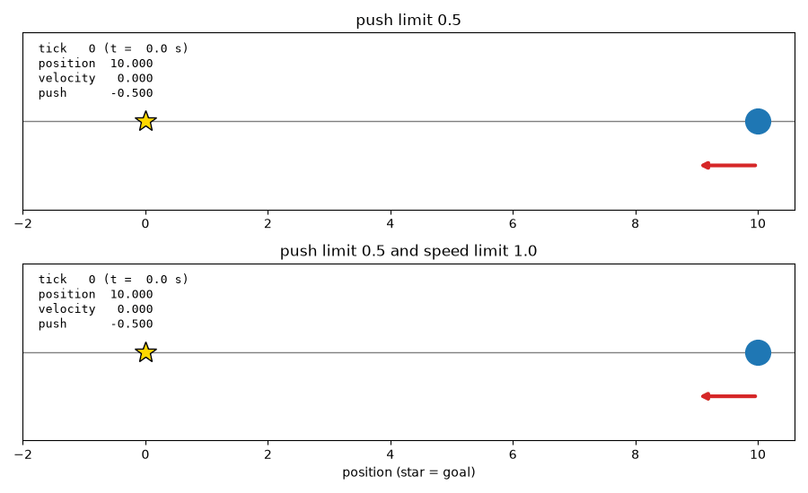

# controlkit

A small C++17 library for robot control. You give it a model of a robot, and it
computes a feedback controller that drives the robot to a goal: first LQR, then
linear MPC, which also respects limits on the pushes and on the state. It is the
control half of a closed-loop autonomy project: slamkit estimates where the robot is,
controlkit decides how to push it.

| LQR | MPC with limits |
|---|---|
|  |  |

*Left: a 1D ball starts 3 m from the goal at rest. The red arrow is the push the
LQR controller chooses each tick. Right: the ball starts 10 m away with a push
limit of 0.5. Top: push limit only. Bottom: push limit and a speed limit of 1.0.*

## What's implemented

- **Model**: a robot is a state size, a control size, and a function that gives
  the time derivative of the state. Any robot can be dropped in.
- **Integrators**: Euler and RK4 one-tick maps (the state after one time step).
- **Linearization**: the matrices $A$ and $B$ of a model near a point, found
  numerically with central differences.
- **LQR**: the optimal feedback gain $K$ for a linear model with a quadratic cost,
  and the cost-to-go matrix $P$ it is built from.
- **Linear MPC**: plans $N$ ticks ahead every tick, with limits on the pushes and on
  the state. The planning problem is a quadratic program, solved with OSQP.
- **Ball demos**: a double integrator (a unit-mass ball pushed along a line),
  controlled to the origin with LQR and with MPC, with CSV output and Python
  animations.

## How it works

A robot has a **state** $x$ (for the ball, position $p$ and velocity $v$) and a
**control** $u$ (for the ball, the push, which is its acceleration). Its
**dynamics** give the time derivative of the state:

$$\dot{x} = f(x, u), \qquad \text{ball: } f(x, u) = (v,\ u)$$

**1. One-tick map.** An integrator turns $f$ into the state after one time step
$\Delta t$ with the control held constant:

$$x_{k+1} = F(x_k, u_k)$$

Euler uses $F = x + \Delta t\, f(x, u)$. RK4 averages four slopes within the tick and
is far more accurate. For the ball, RK4 is exact.

**2. Straighten near the goal.** LQR and linear MPC need a linear rule. Near the goal
(a resting point, so $F(x_g, u_g) = x_g$), the first-order Taylor expansion of $F$
gives the error dynamics

$$\delta x_{k+1} = A\, \delta x_k + B\, \delta u_k, \qquad A = \frac{\partial F}{\partial x}, \quad B = \frac{\partial F}{\partial u}$$

where $\delta x = x - x_g$ and $\delta u = u - u_g$. For the ball at $\Delta t = 0.1$:

$$A = \begin{pmatrix} 1 & 0.1 \\ 0 & 1 \end{pmatrix}, \qquad B = \begin{pmatrix} 0.005 \\ 0.1 \end{pmatrix}$$

**3. Say what a good controller is.** Each tick costs a penalty, and the total cost
$J$ scores a whole run:

$$J = \sum_{k=0}^{\infty} \left( \delta x_k^\top Q\, \delta x_k + \delta u_k^\top R\, \delta u_k \right)$$

$Q$ is how much we dislike error and $R$ is how much we dislike effort.

**4. LQR finds $K$ once, offline.** Of all ways to choose the controls, the rule
$\delta u = -K\, \delta x$ gives the smallest $J$. $K$ comes from the cost-to-go
matrix $P$, found by repeating the following until $P$ stops changing, starting
from $P = 0$:

$$K = (R + B^\top P B)^{-1} B^\top P A, \qquad P \leftarrow Q + A^\top P\, (A - BK)$$

Every tick, read the state, compute the push, and step:

$$u_k = u_g - K\,(x_k - x_g), \qquad x_{k+1} = F(x_k, u_k)$$

The controller is one matrix multiply per tick. It cannot see limits: clipping its
push to the motor's range works when the limit rarely bites, but overshoots
when the limit bites for a long time, because LQR plans as if it could always brake hard.

**5. MPC plans with the limits built in.** Every tick:

1. Read the state and compute the error $\delta x_0$.
2. Plan the next $N$ pushes $U = (\delta u_0, \dots, \delta u_{N-1})$ that minimize the plan cost, subject to the limits.
3. Apply only the first push, then plan again from the new state.

*Prediction.* Rolling the rule forward gives all predicted errors
$X = (\delta x_1, \dots, \delta x_N)$ as a straight-line function of the pushes:

$$X = \mathcal{A}\,\delta x_0 + \mathcal{B}\,U, \qquad \mathcal{A} = \begin{pmatrix}A\\ A^2\\ \vdots\\ A^N\end{pmatrix}, \quad \mathcal{B} = \begin{pmatrix}B & & \\ AB & B & \\ \vdots & & \ddots\end{pmatrix}$$

*Cost.* The plan is scored with the same $Q$ and $R$, plus a terminal cost that
uses LQR's $P$ to stand for everything after tick $N$:

$$J_{\text{plan}} = \sum_{k=0}^{N-1}\left(\delta x_k^\top Q\, \delta x_k + \delta u_k^\top R\, \delta u_k\right) + \delta x_N^\top P\, \delta x_N$$

With no limits, this is LQR.

*Limits.* Push limits and state limits (such as a speed limit) are both straight-line
conditions on $U$, so all of them stack into one form:

$$\ell \le M\,U \le \mu, \qquad M = \begin{pmatrix} I \\ \mathcal{B} \end{pmatrix}$$

*The problem to solve each tick* is a quadratic program (QP):

$$\min_U\ \tfrac12\, U^\top H\, U + g^\top U \quad \text{subject to} \quad \ell \le M\,U \le \mu$$

$$H = 2\left(\mathcal{B}^\top \bar{Q}\,\mathcal{B} + \bar{R}\right), \qquad g = 2\,\mathcal{B}^\top \bar{Q}\,\mathcal{A}\,\delta x_0$$

where $\bar{Q}$ is $Q$ repeated down the diagonal with $P$ as the last block, and $\bar{R}$ is
$R$ repeated. $H$ and $M$ never change, so they are built once. Each tick only
$g$ and the bounds change, because they depend on the current error $\delta x_0$.

## Results

### LQR

The ball model, with $\Delta t = 0.1$, $Q = I$, $R = 1$, goal at the origin,
starting at $p = 3$, $v = 0$. LQR returns $K = (0.917,\ 1.636)$.

| Tick | Position | Velocity | Push |
|---|---|---|---|
| 0 | 3.000 | 0.000 | -2.751 |
| 10 | 2.157 | -1.211 | 0.002 |
| 20 | 1.062 | -0.894 | 0.489 |
| 50 | 0.009 | -0.047 | 0.069 |
| 100 | -0.001 | 0.001 | -0.001 |

The ball is within 1 mm of the goal and nearly at rest by tick 100. The numerical
$A$ and $B$ match the exact values above to the six digits printed.

### MPC

The same ball and costs, starting at $p = 10$, $v = 0$, with horizon $N = 20$
(2 s), push limit $|u| \le 0.5$, goal at the origin.

| Case | Settled at tick | Lowest position | Top speed |
|---|---|---|---|
| Push limit only | 133 | -0.716 | 2.286 |
| Push limit and speed limit 1.0 | 131 | -0.011 | 1.000 |

"Settled" is the first tick where the state is within 0.05 of the goal (the norm of position and velocity).

With only a push limit, the ball is still pushing at the limit at tick 30, builds up
speed, and cannot brake in time, so it overshoots the goal by 0.72 m. With the speed
limit, the planner sees the speed cap coming: the speed holds at exactly 1.0 from about tick 30 to 90, and
the ball glides in with about 1 cm of overshoot, and settles slightly sooner.

## Code walkthrough

Each piece is a plain struct or free function, in the same style as slamkit.

| File | What it does |
|---|---|
| `include/controlkit/model.hpp` | `Model` struct: `state_dim`, `control_dim`, and `dynamics(state, control)`, which returns the time derivative of the state. `dynamics` is a `std::function`, so any function can be plugged in. |
| `include/controlkit/double_integrator.hpp`, `src/double_integrator.cpp` | `make_double_integrator()` builds the ball model: state $(p, v)$, control $u$, $\dot{x} = (v, u)$. |
| `include/controlkit/integrators.hpp`, `src/integrators.cpp` | `euler_step` and `rk4_step`: state after one time step for a given state, control and step size. This is $F$. |
| `include/controlkit/linearize.hpp`, `src/linearize.cpp` | `linearize(model, state, control, time_step)` returns a `LinearModel` with $A$ and $B$. Column $j$ is found by nudging input $j$ by $\pm 10^{-6}$, running `rk4_step`, and dividing the difference by $2 \times 10^{-6}$. |
| `include/controlkit/lqr.hpp`, `src/lqr.cpp` | `solve_riccati(A, B, Q, R)` returns the cost-to-go matrix $P$ by repeating the loop from step 4 until it changes by less than $10^{-10}$ (at most 10000 rounds). `lqr(A, B, Q, R)` returns $K$ from that $P$. Both solve with Eigen's LDLT instead of forming an inverse. |
| `include/controlkit/mpc.hpp`, `src/mpc.cpp` | `make_mpc(...)` builds $\mathcal{A}$, $\mathcal{B}$, $H$ and $M$ once and sets up OSQP. `mpc_control(mpc, state)` runs one tick: computes $g$ and the bounds from the current state, solves the QP, and returns the first push. `destroy_mpc(mpc)` frees the solver. `no_limit` marks an unlimited entry. |
| `apps/ball_demo.cpp` | Runs LQR on the ball and writes `ball.csv`. |
| `apps/ball_mpc_demo.cpp` | Runs MPC on the ball in the two cases above, writes `ball_mpc_push_only.csv` and `ball_mpc_speed.csv`, then launches the animation. |
| `python_plotting/animate_ball.py`, `python_plotting/animate_ball_mpc.py` | Animate the CSV files and save the GIFs in `docs/`. |

## Build and run

Requires a C++17 compiler, CMake 3.20+, Eigen 3, [OSQP](https://osqp.org) 1.x
(`brew install osqp` on macOS), and Python with numpy and matplotlib for the
animations. Builds in Release mode by default.

```
cmake -S . -B build
cmake --build build

# LQR: prints A, B, K and a few ticks, writes ball.csv
./build/ball_demo
python python_plotting/animate_ball.py

# MPC: runs both cases, then opens the animation and saves docs/ball_mpc.gif
./build/ball_mpc_demo
```

Run both from the top of the repo, because the CSV, script and GIF paths are
relative to it.

## Project layout

```
include/controlkit/   public headers
src/                  library implementation
apps/                 runnable programs (ball_demo, ball_mpc_demo)
python_plotting/      animation scripts
docs/                 figures used in this README
```

## Design decisions

- **Control only, no simulator.** controlkit has no plant and no sensors. The
  repo that runs the full loop supplies the simulated robot and calls
  controlkit with a state.
- **A model is a struct.** Changing robots means filling in three fields, so the
  loop repo can swap robots without touching controlkit.
- **Jacobians by finite differences.** `linearize` works on any `Model`
  without hand-derived derivatives. Central differences are used because they
  cancel the first-order error.
- **RK4 for the one-tick map.** Halving the step cuts RK4's error by about 16x,
  versus about 2x for Euler.
- **Solve instead of invert.** The LQR gain is computed by solving a linear system,
  which is more accurate than forming an inverse.
- **$K$ is computed once.** The LQR loop only does a matrix multiply per tick.
- **MPC uses OSQP for the QP.** The matrices $H$ and $M$ are built once, so each tick
  only updates the gradient and the bounds. Tolerances are set to $10^{-6}$ and the
  other OSQP settings are left at their defaults.
- **Terminal cost from LQR.** Using $P$ at the end of the horizon makes the plan
  agree with the infinite-horizon cost, so MPC without limits is LQR.
- **Limits are given in real units**, and converted into errors from the goal inside
  `make_mpc`.

## Limitations

- **No unit tests yet.** The code was checked by running the demos against hand-derived
  and independently computed values, not by an automated test suite.
- **Linear model only.** The model is linearized once, at the goal. That is
  exact for the ball, but a robot that cannot be controlled when linearized at rest
  (like a unicycle) needs a time-varying version.
- **The horizon matters.** With a push limit only, the 2 s horizon is shorter than the time
  needed to brake from top speed, which is why the ball overshoots by 0.72 m. In a Python replica of the
  same problem, a 4 s horizon (`horizon = 40`) cut the overshoot to about 0.18 m.
- **Solve time is not measured yet.**
- **Limits are constant** over the horizon and over time.
- **If OSQP does not return a solution**, `mpc_control` prints a warning and applies the
  goal control. There is no smarter fallback.
- **An `Mpc` must not be copied**, and `destroy_mpc` must be called once.
- **Only the ball model.** No other robot is implemented yet.

## Roadmap

- [ ] Unit tests for the model, integrators, linearization, LQR and MPC
- [ ] Measure MPC solve time
- [ ] Unicycle model
- [ ] Time-varying LQR and MPC along a reference path
- [ ] A separate loop repo: simulator, slamkit EKF feeding controlkit, ROS 2, latency measurement, Docker, CI