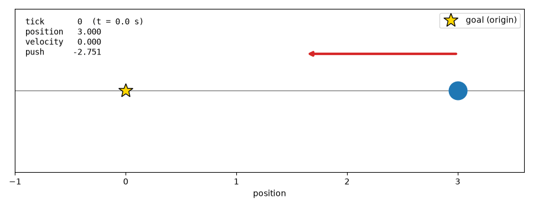

# controlkit

A C++17 library for robot control. You give it a model of a robot, and it
computes a feedback controller that drives the robot to a goal. It is the
control half of a closed-loop autonomy project: slamkit estimates where the robot is,
controlkit decides how to push it.



*A 1D ball starts 3 m from the goal at rest. The red arrow is the push the
controller chooses each tick. The controller pushes toward the goal, eases off at
tick 10, then brakes so the ball stops on the goal.*

## What's implemented

- **Model**: a robot is a state size, a control size, and a function that gives
  the time derivative of the state. Any robot can be dropped in.
- **Integrators**: Euler and RK4 one-tick maps (the state after one time step).
- **Linearization**: the matrices $A$ and $B$ of a model near a point, found
  numerically with central differences.
- **LQR**: the optimal feedback gain $K$ for a linear model with a quadratic cost.
- **Ball demo**: a double integrator (a unit-mass ball pushed along a line),
  controlled to the origin, with a CSV output and a Python animation.

## How it works

A robot has a **state** $x$ (for the ball, position $p$ and velocity $v$) and a
**control** $u$ (for the ball, the push, which is its acceleration). Its
**dynamics** give the time derivative of the state:

$$\dot{x} = f(x, u), \qquad \text{ball: } f(x, u) = (v,\ u)$$

**1. One-tick map.** An integrator turns $f$ into the state after one time step
$\Delta t$ with the control held constant:

$$x_{k+1} = F(x_k, u_k)$$

Euler uses $F = x + \Delta t\, f(x, u)$. RK4 averages four slopes within the tick and
is far more accurate. For the ball, RK4 is exact.

**2. Straighten near the goal.** LQR needs a linear rule. Near the goal (a resting
point, so $F(x_g, u_g) = x_g$), the first-order Taylor expansion of $F$ gives
the error dynamics

$$\delta x_{k+1} = A\, \delta x_k + B\, \delta u_k, \qquad A = \frac{\partial F}{\partial x}, \quad B = \frac{\partial F}{\partial u}$$

where $\delta x = x - x_g$ and $\delta u = u - u_g$. For the ball at $\Delta t = 0.1$:

$$A = \begin{pmatrix} 1 & 0.1 \\ 0 & 1 \end{pmatrix}, \qquad B = \begin{pmatrix} 0.005 \\ 0.1 \end{pmatrix}$$

**3. Say what a good controller is.** Each tick costs a penalty, and the total cost
$J$ scores a whole run:

$$J = \sum_{k=0}^{\infty} \left( \delta x_k^\top Q\, \delta x_k + \delta u_k^\top R\, \delta u_k \right)$$

$Q$ is how much we dislike error and $R$ is how much we dislike effort.

**4. LQR finds $K$ once, offline.** Of all ways to choose the controls, the rule
$\delta u = -K\, \delta x$ gives the smallest $J$. $K$ comes from the cost-to-go
matrix $P$, found by repeating the following until $P$ stops changing, starting
from $P = 0$:

$$K = (R + B^\top P B)^{-1} B^\top P A, \qquad P \leftarrow Q + A^\top P\, (A - BK)$$

**5. Run the robot.** Every tick, read the state, compute the push, and step:

$$u_k = u_g - K\,(x_k - x_g), \qquad x_{k+1} = F(x_k, u_k)$$

The controller is one matrix multiply per tick.

## Results

The ball model, with $\Delta t = 0.1$, $Q = I$, $R = 1$, goal at the origin,
starting at $p = 3$, $v = 0$. LQR returns $K = (0.917,\ 1.636)$.

| Tick | Position | Velocity | Push |
|---|---|---|---|
| 0 | 3.000 | 0.000 | -2.751 |
| 10 | 2.157 | -1.211 | 0.002 |
| 20 | 1.062 | -0.894 | 0.489 |
| 50 | 0.009 | -0.047 | 0.069 |
| 100 | -0.001 | 0.001 | -0.001 |

The ball is within 1 mm of the goal and nearly at rest by tick 100. The numerical
$A$ and $B$ match the exact values above to the six digits printed.

## Code walkthrough

Each piece is a plain struct or free function, in the same style as slamkit.

| File | What it does |
|---|---|
| `include/controlkit/model.hpp` | `Model` struct: `state_dim`, `control_dim`, and `dynamics(state, control)`, which returns the time derivative of the state. `dynamics` is a `std::function`, so any function can be plugged in. |
| `include/controlkit/double_integrator.hpp`, `src/double_integrator.cpp` | `make_double_integrator()` builds the ball model: state $(p, v)$, control $u$, $\dot{x} = (v, u)$. |
| `include/controlkit/integrators.hpp`, `src/integrators.cpp` | `euler_step` and `rk4_step`: state after one time step for a given state, control and step size. This is $F$. |
| `include/controlkit/linearize.hpp`, `src/linearize.cpp` | `linearize(model, state, control, time_step)` returns a `LinearModel` with $A$ and $B$. Column $j$ is found by nudging input $j$ by $\pm 10^{-6}$, running `rk4_step`, and dividing the difference by $2 \times 10^{-6}$. |
| `include/controlkit/lqr.hpp`, `src/lqr.cpp` | `lqr(A, B, Q, R)` returns $K$. It repeats the loop from step 4 until $P$ changes by less than $10^{-10}$ (at most 10000 rounds), solving with Eigen's LDLT instead of forming an inverse. |
| `apps/ball_demo.cpp` | Runs the full pipeline on the ball and writes `ball.csv`. |
| `python_plotting/animate_ball.py` | Animates `ball.csv`. |

## Build and run

Requires a C++17 compiler, CMake 3.20+, Eigen 3, and Python with numpy and
matplotlib for the animation. Builds in Release mode by default.

```
cmake -S . -B build
cmake --build build

# run the ball demo (prints A, B, K and a few ticks, writes ball.csv)
./build/ball_demo

# animate it
python python_plotting/animate_ball.py
```

To save the animation as a GIF, uncomment the `animation.save(...)` line in
`animate_ball.py`.

## Project layout

```
include/controlkit/   public headers
src/                  library implementation
apps/                 runnable programs (ball_demo)
python_plotting/      animation script
docs/                 figures used in this README
```

## Design decisions

- **Control only, no simulator.** controlkit has no plant and no sensors. The
  repo that runs the full loop supplies the simulated robot and calls
  controlkit with a state.
- **A model is a struct.** Changing robots means filling in three fields, so the
  loop repo can swap robots without touching controlkit.
- **Jacobians by finite differences.** `linearize` works on any `Model`
  without hand-derived derivatives. Central differences are used because they
  cancel the first-order error.
- **RK4 for the one-tick map.** Halving the step cuts RK4's error by about 16x,
  versus about 2x for Euler.
- **Solve instead of invert.** The gain is computed by solving a linear system,
  which is more accurate than forming an inverse.
- **$K$ is computed once.** The control loop only does a matrix multiply per tick.

## Limitations

- **No unit tests yet.** The code was checked by running the ball demo against
  hand-derived and independently computed values, not by an automated test
  suite.
- **Linear control only.** LQR straightens the robot around one point, so it is
  accurate near that point. Robots that cannot be controlled when linearized at
  rest (like a unicycle) need the time-varying version below.
- **No constraints.** Pushes are unbounded and there are no limits on the state.
- **Only the ball model.** No other robot is implemented yet.

## Roadmap

- [ ] Unit tests for the model, integrators, linearization and LQR
- [ ] Unicycle model
- [ ] Time-varying LQR along a reference path
- [ ] Linear MPC with input and state constraints
- [ ] A separate loop repo: simulator, slamkit EKF feeding controlkit, ROS 2, latency measurement, Docker, CI
